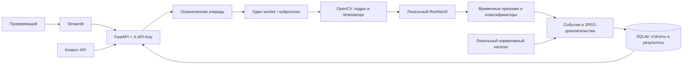

# ForteVision

### Локальный AI-помощник для проверки кассовых видеозаписей

**Datathon 26 · кейс ForteBank**

`FastAPI` · `Streamlit` · `PyTorch / torchvision` · `OpenCV` · `scikit-learn` · `Docker`

ForteVision помогает проверяющему перейти от просмотра всей записи к конкретным фрагментам: загрузить видео, получить временные отметки, увидеть кадры-доказательства и проверить гипотезу о действии в контексте нормативных источников Республики Казахстан.

Анализ выполняется локально. Видео, кадры и их описания не передаются облачным AI-сервисам. Распознавание и идентификация лиц не используются. Результат предназначен для проверки человеком, а не для автоматического юридического или дисциплинарного заключения.

> **Статус на 18 октября 2026 года.** UI, API и локальная обработка работают. Активная модель `anchored_v3` обучена по временным отметкам, но **не прошла проверку качества для автоматического обнаружения**. Она работает в режиме гипотез для ручного просмотра.

**Навигация:** [Возможности](#возможности) · [Архитектура](#архитектура) · [Запуск](#быстрый-запуск) · [Docker](#docker) · [ML](#как-работает-ml) · [Качество](#качество-и-ограничения) · [Обучение](#данные-и-обучение) · [Нормативы](#нормативная-база) · [Проверки](#проверки)

## Возможности

| Компонент | Реализовано |
| --- | --- |
| Веб-интерфейс | Загрузка видео, статус обработки, события, таймкоды, кадры и контекст; светлая и тёмная темы |
| Анализ | Локальные визуальные признаки, перекрывающиеся окна, бинарный сигнал и отдельные гипотезы типов |
| Доказательства | 1–3 настоящих JPEG-кадра на событие, base64 для API, временные отметки из видео |
| Нормативный справочник | Источники РК, условия применимости и ограничения в отдельном разделе UI |
| API | Авторизация `X-API-Key`, загрузка, асинхронные задания, получение и удаление результатов |
| Надёжность | Ограниченная очередь, контроль размера и времени, SQLite, TTL, очистка временных загрузок |
| Обратная связь | Локальное сохранение замечаний проверяющего, без автоматического дообучения |
| Переносимость | Python или Docker; inference без скачивания весов и внешних AI API |

Основной формат — **`.mov`**; дополнительно принимаются `.mp4` и `.m4v`. Звук не анализируется. Отсутствующие или повреждённые модели приводят к ошибке, а не к фиктивному результату «нарушений нет».

## Архитектура



HTTP-запрос не ждёт окончания анализа: сервер возвращает `job_id`, а клиент опрашивает статус. Один worker последовательно обрабатывает задания. Бюджет **295 секунд** учитывает загрузку, очередь и обработку. Это ограничение времени, а не гарантия завершения любого видео на любом оборудовании.

SQLite сохраняет завершённые результаты между перезапусками до истечения TTL. Незавершённые задания после перезапуска получают `failed`. Для одной БД предусмотрен один процесс-владелец; распределённая очередь и горизонтальное масштабирование в MVP не реализованы.

### Структура проекта

```text
fortevision/
├── app/
│   ├── api.py                  # FastAPI и маршруты
│   ├── frontend.py             # Streamlit
│   ├── schemas.py              # JSON-контракт и валидация JPEG
│   ├── jobs.py                 # Очередь, subprocess, SQLite, TTL
│   ├── config.py               # Настройки окружения
│   ├── security.py             # Авторизация и лимиты
│   ├── rule_links.py           # Проверяемые ссылки на нормативы
│   └── review_feedback.py      # Замечания проверяющего
├── ml/
│   ├── pipeline.py             # Полный анализ видео
│   ├── preprocessing.py        # Декодирование, sampling, окна
│   ├── detection.py            # ResNet18, локальные веса
│   ├── anchored.py             # Обучение по отметкам времени
│   ├── sequence.py             # Признаки изменений во времени
│   ├── temporal.py             # Объединение окон в события
│   ├── evidence.py             # JPEG-кадры
│   ├── dataset.py              # Разметка, ID, хеши, manifest
│   ├── triage.py               # Режим ручной проверки
│   └── rules.py                # Нормативный каталог
├── scripts/                    # Запуск, диагностика, обучение
├── research/                   # Исследование нормативов и отчёт
├── configs/                    # Runtime-правила и аудит источников
├── tests/                      # Программные проверки
├── docs/                       # Развёртывание, ML, хранение данных
├── data/raw/                   # Приватная разметка, не в Git
├── data/videos/                # Приватные видео, не в Git
├── models/                     # Веса и metadata, не в Git
├── artifacts/                  # Локальные отчёты и кеш, не в Git
├── .env.example                # Шаблон конфигурации без секретов
├── requirements.txt
├── requirements-dev.txt
├── Dockerfile
├── compose.yaml
└── compose.public.yaml         # Дополнительная HTTPS-конфигурация
```

В `ml/` и `scripts/` сохранены предыдущие эксперименты. Текущая точка входа обучения — **`scripts.train_anchored`**, активный артефакт — **`anchored_v3`**. Старые скрипты не являются последовательностью обязательных шагов запуска.

## Соответствие требованиям ForteBank Datathon 26

ForteVision разработан как воспроизводимый прототип AI-сервиса для анализа видеозаписей банковских кассовых операций с акцентом на локальность, объяснимость и интеграционную готовность.

**Ключевые инженерные результаты проекта:**

- **End-to-end pipeline:** загрузка видео, асинхронная обработка, извлечение временных признаков, формирование гипотез событий и отображение кадров-доказательств в едином интерфейсе.
- **Local-first AI:** модели ResNet18 и классификаторы выполняются локально, без передачи видео и кадров внешним AI-сервисам.
- **Explainable compliance:** предусмотрен нормативный справочник Республики Казахстан с источниками, условиями применимости и ограничениями юридической интерпретации.
- **API readiness:** реализованы маршруты обработки заданий, авторизация через `X-API-Key`, проверка форматов и управление жизненным циклом результатов.
- **Reproducibility:** предоставлены Docker-конфигурация, инструкции запуска, диагностика окружения и автоматизированные проверки. Последний прогон включал 119 успешно завершённых pytest-тестов.

### Принципы проверки результата

Проект следует оценивать с разделением двух аспектов: инженерной готовности сервиса и фактического качества ML-детекции.

Функциональность, локальность и корректность API можно проверить по инструкциям запуска. Для оценки распознавания приведены результаты групповой cross-validation и отложенной выборки в разделе [Качество и ограничения](#качество-и-ограничения).

Текущая модель `anchored_v3` остаётся экспериментальной: несмотря на высокую полноту обнаружения на исследованной выборке, ложные срабатывания и ошибки определения типа и времени события не позволяют считать автоматическую классификацию надёжно подтверждённой.

**Основная ценность ForteVision** — интегрированная архитектура, объединяющая видеоаналитику, нормативный контекст, локальную обработку и проверяемые доказательства, с возможностью дальнейшего улучшения ML-компонента без переработки пользовательского интерфейса и API.


## Быстрый запуск

### 1. Окружение

Рекомендуется **Python 3.11 x64**. Последняя локальная проверка выполнена на Python **3.12.14**, CPU; Docker использует Python 3.11. CUDA не обязательна. Команды ниже — для PowerShell, из корня проекта.

```powershell
git clone https://github.com/aikinovatomiris/ForteVision.git
cd ForteVision
py -3.11 -m venv .venv
.\.venv\Scripts\python.exe -m pip install -r requirements-dev.txt
.\.venv\Scripts\python.exe -m scripts.init_env
```

`requirements-dev.txt` включает runtime-зависимости и тестирование. Для исполнения без тестов достаточно `requirements.txt`. Активация venv не требуется при использовании полного пути к Python.

`scripts.init_env` создаёт `.env` со случайным API-ключом, не выводит ключ в терминал и **не перезаписывает** существующий файл. Для ранее созданного `.env` значения путей должны соответствовать выбранному комплекту моделей.

### 2. Модели

**Одного `git clone` недостаточно:** модели и приватные данные намеренно отсутствуют в Git. Для анализа нужны три согласованных файла из доверенной локальной сборки:

```text
models/
├── anchored_v3.joblib          # Обученные классификаторы
├── anchored_v3.json            # Конфигурация, происхождение, SHA-256
└── resnet18-f37072fd.pth        # Веса извлекателя признаков
```

Joblib может исполнять код при загрузке, поэтому поддерживается использование только доверенных артефактов. Совместимость весов и metadata проверяется приложением. Для запуска готовой модели обучающие видео не нужны.

Backbone можно заранее скачать с официального источника:

```powershell
.\.venv\Scripts\python.exe -m scripts.prepare_weights
```

Команда требует сети при отсутствии весов и **не создаёт классификатор событий**. Классификатор передаётся вместе со сборкой либо обучается отдельно на разрешённых данных.

### 3. Конфигурация и запуск

Основные значения `.env`:

```dotenv
FORTEVISION_MODEL=models/anchored_v3.joblib
FORTEVISION_WEIGHTS=models/resnet18-f37072fd.pth
FORTEVISION_DEVICE=cpu
FORTEVISION_BACKEND=classifier
FORTEVISION_START_VLM=0
FORTEVISION_API_URL=http://127.0.0.1:8000
FORTEVISION_CONTAINER_MODEL=/app/models/anchored_v3.joblib
```

Сгенерированный `FORTEVISION_API_KEY` хранится только в локальном `.env` и не входит в публичную документацию или Git.

```powershell
.\.venv\Scripts\python.exe -B -m scripts.preflight
.\.venv\Scripts\python.exe -B -m scripts.serve
```

| Адрес | Назначение |
| --- | --- |
| http://127.0.0.1:8501 | Веб-интерфейс |
| http://127.0.0.1:8000/health | Доступность API |
| http://127.0.0.1:8000/ready | Готовность конфигурации и локальных моделей |

`preflight` отдельно показывает `runtime_ready` и `automatic_detection_ready`: готовность к исполнению не означает подтверждённую точность. Остановка — **Ctrl+C**. Порты 8000/8501 должны быть свободны; альтернативный запуск:

```powershell
.\.venv\Scripts\python.exe -B -m scripts.serve --api-port 8001 --ui-port 8502
```

Пользовательский сценарий: **загрузка видео → запуск анализа → статус обработки → карточки событий**. Карточки показывают время, гипотезу действия, кадры и контекст. После смены модели применяется новый анализ: сохранённые задания не пересчитываются автоматически.

## Docker

Нужны Docker Engine/Compose, подготовленный `.env` и файлы моделей. Первая сборка скачивает базовый образ и зависимости; inference после подготовки не требует интернета.

Порядок запуска в Windows:

1. Запущен Docker Desktop с Linux-контейнерами; команды выполняются из каталога клонированного проекта.
2. В `models/` размещены `anchored_v3.joblib`, `anchored_v3.json` и `resnet18-f37072fd.pth`.
3. Локальный `.env` создан через `scripts.init_env`, как в разделе «Быстрый запуск». Ключ заменён случайным значением автоматически, `FORTEVISION_CONTAINER_MODEL=/app/models/anchored_v3.joblib`.
4. Предыдущий Python-запуск остановлен через Ctrl+C, чтобы освободить порты 8000 и 8501.
5. Проверка конфигурации и сборка выполняются следующими командами:

```powershell
docker compose config --quiet
docker compose up -d --build
docker compose ps
docker compose logs --tail 100 app
```

UI и API доступны на тех же адресах `127.0.0.1:8501` и `127.0.0.1:8000`.

| Объект | Поведение |
| --- | --- |
| Контейнер `app` | Python 3.11, CPU PyTorch; API и UI запускаются вместе |
| `models`, `configs`, `research` | Подключены с хоста только для чтения |
| Загруженные видео | Временный `tmpfs`, лимит 1 GiB |
| SQLite | Именованный volume `job_state` |
| Порты | По умолчанию доступны только с локальной машины |
| Healthcheck | Проверяет `/ready` и здоровье Streamlit |

После запуска `docker compose ps` показывает состояние контейнера, а `http://127.0.0.1:8000/ready` возвращает успешный ответ при корректных моделях и ключе. Сообщения об ошибках доступны через `docker compose logs --tail 100 app`.

Остановка: `docker compose down`. Volume с результатами сохраняется; флаг `-v` удаляет его. Повторный запуск без пересборки: `docker compose up -d`. Применение новой конфигурации модели: `docker compose up -d --force-recreate`. После изменения исходного кода требуется `docker compose up -d --build`.

**Последняя версия `anchored_v3` проверена в native Python; Docker после этой пересборки ML не проверялся.** Перенос образа и настройка HTTPS описаны в [DEPLOYMENT.md](docs/DEPLOYMENT.md).

## Как работает ML

1. **Кадры.** OpenCV читает видео с фактическими временными отметками декодера; sampling — 2 кадра/с.
2. **Признаки.** Замороженный ResNet18 извлекает embeddings. Используется полный кадр с сохранением пропорций и нормализацией. Веса загружаются только с диска.
3. **Время.** Окна длиной 4 с идут с шагом 2 с. Mean/max pooling даёт 1024 признака; дополнительно анализируются изменения до/после окна и относительно медианы записи.
4. **Классификация.** Отдельный LogisticRegression даёт бинарную оценку. Независимые классификаторы типов допускают несколько действий в одном фрагменте. StandardScaler обучается только на обучающей части каждого fold.
5. **События.** Положительные окна объединяются; выбирается пик оценки и извлекаются кадры. При недостаточной уверенности тип остаётся общим.
6. **Объяснение.** Для предсказанного типа используется осторожный шаблон. Это не свободное описание видео и не поиск ответа из Excel по имени файла.

ResNet не дообучается на пользовательских загрузках. Имена, номера роликов, их хеши и тексты разметки не являются входными признаками при inference. Замечания пользователя сохраняются как ожидающие проверки и не запускают обучение автоматически.

**Техническая точность timestamp не равна точности локализации действия.** Доли секунды относятся к кадру; событие оценивается четырёхсекундными окнами и может быть локализовано ошибочно. Оценки модели не являются калиброванными вероятностями нарушения.

<details>
<summary><strong>Категории текущей обучающей разметки</strong></summary>

Это названия визуальных гипотез, а не перечень надёжно распознаваемых или юридически подтверждённых нарушений.

| Категория | Независимые обучающие видео |
| --- | ---: |
| Ручной пересчёт не наблюдается | 2 |
| Деньги предыдущего клиента не убраны | 1 |
| Помещение денег без наблюдаемого пересчёта | 1 |
| Деньги оставлены без присмотра | 1 |
| Одновременное обслуживание клиентов | 1 |
| Хранилище предположительно не закрыто | 2 |
| Компьютер оставлен после ухода | 1 |
| Дверь оставлена открытой | 1 |
| Проверка банкнот не наблюдается | 1 |
| Еда или напитки рядом с деньгами | 1 |

Один ролик может участвовать в нескольких категориях. Некоторые типы отложенной выборки вообще отсутствуют в обучении; отсутствие бумажного документа, включённый экран или положение дверцы сами по себе не доказывают нарушение.

</details>

## Качество и ограничения

После объединения дубликатов доступны **40 уникальных видео**. В новой разметке вручную перенесены **19 отметок действий**. Сохранены 8 исходных отложенных видео; ещё 6 связанных с ними роликов исключены из обучения. Из 26 development-видео 22 пригодны для обучения по известным нормальным меткам или отметкам событий.

| Проверка `anchored_v3` | Результат |
| --- | --- |
| Групповая cross-validation development | TP=13, FN=1, FP=7, TN=5; precision 0,65, recall 0,929 |
| 8 отложенных видео | TP=4, FN=0, FP=4, TN=0 |
| Отложенные события с новыми отметками времени | 2 из 4 совпали с предсказанием в пределах ±5 с |
| Одновременно правильные тип и время на отложенных событиях | 0 из 4 |
| Реальная загрузка X-4 через API | Около 19,7 с; гипотезы около 32,03 и 58,03 с |
| Последний полный запуск программных проверок | 119 pytest-тестов прошли; 2 предупреждения зависимостей |

**На отложенной выборке сигнал получен на каждом видео, включая все нормальные.** Полнота 100% здесь не означает полезное различение классов. X-4 участвовал в обучении: его результат не доказывает обобщение. Cross-validation использовалась для выбора параметров; отложенные записи ранее исследовались командой и не являются новым слепым benchmark. Проверка на новом ракурсе ещё не выполнена.

Основные ограничения:

- Большинство типов представлены одним независимым обучающим роликом; переобучение и ложные тревоги остаются существенной проблемой.
- Нет новой точной временной разметки для X-32, X-33, X-34, X-38 и X-40; для части видео не хватает описания действия.
- Нет надёжных предметных детекторов документов, банкнот, ключей и запирания. Визуальное сходство не подтверждает выполнение всех этапов операции.
- Не устанавливаются идентификация вне кадра, данные АБИС, корректность проводок, подлинность банкнот и другие невидимые обстоятельства.
- Не подтверждены устойчивость к другому ракурсу/перекрытиям и выполнение лимита пяти минут на любом оборудовании.

Актуальный эксперимент: [ANCHORED_TRAINING.md](docs/ANCHORED_TRAINING.md). Исторические проверки: [VALIDATION.md](VALIDATION.md); результаты старых моделей относятся к другим вариантам разметки и не заменяют текущую оценку.

## Данные и обучение

### Подготовка

Видео помещаются в `data/videos/`, исходная таблица — в `data/raw/open_labels.xlsx`. Колонки исходной таблицы: `наименование файла`, `таймстемп`, `нарушение / без нарушения`. Нормализация учитывает латинскую `X` и кириллическую `Х`; пропуски номеров допустимы. SHA-256 позволяет обнаружить копии под разными именами.

```powershell
.\.venv\Scripts\python.exe -m scripts.inspect_dataset
.\.venv\Scripts\python.exe -m scripts.contact_sheets --video-id X-4 --radius 5
```

Первый скрипт проверяет метки, файлы, timestamps, длительности/FPS и дубликаты; отчёт — `artifacts/dataset_inspection.json`. Это проверка метаданных, не вывод о содержимом видео. Второй сохраняет contact sheets около исходных отметок только локально.

### Обучение по описаниям и секундам

Для воспроизведения нужны приватные артефакты команды:

| Файл | Назначение |
| --- | --- |
| `data/raw/fortevis_%D0…xlsx` | Новая таблица с бинарными метками и текстовыми описаниями по секундам |
| `data/raw/temporal_annotations_v2.json` | Проверенная транскрипция событий, группы записей, SHA-256 Excel |
| `artifacts/manifest.json` | Файлы, хеши, исходное разделение выборок |
| `data/videos/` | Разрешённые обучающие и внутренние проверочные видео |
| `models/resnet18-f37072fd.pth` | Локальный backbone |

Эти файлы не появляются после клонирования репозитория. JSON событий нельзя получить слепым извлечением всех чисел из описания: моменты обычных действий нужно отличать от событий. При изменении Excel транскрипцию необходимо перепроверить; несовпадение хеша останавливает обучение.

```powershell
$workbook = "data/raw/fortevis_%D0%BD%D0%B0%D1%80%D1%83%D1%88%D0%B5%D0%BD%D0%B8%D1%8F.xlsx"
.\.venv\Scripts\python.exe -m scripts.train_anchored --workbook $workbook --annotations data/raw/temporal_annotations_v2.json --name anchored_new --objective precision
```

Скрипт проверяет данные, извлекает или переиспользует проверенный кеш признаков, выполняет групповую cross-validation, фиксирует модель и порог, затем оценивает отложенную выборку. Окна одного видео не разделяются между train и validation. Неотмеченные участки положительного видео не считаются подтверждённой нормой; эксперимент со слабыми отрицательными использует меньший вес и только фрагменты задолго до первого события.

Результат — `models/anchored_new.joblib`, `models/anchored_new.json` и отчёты `artifacts/anchored_new/`: `data_audit.json`, `selection.json`, `test_evaluation.json`, `release_gate.json`. Существующая модель не перезаписывается. **Обучение само не переключает сервис на новый файл.** Переключение требует отдельной оценки отчётов; текущие v2 и v3 не прошли автоматический release gate.

Для развития нужны независимые положительные примеры и похожие нормальные операции, начало/конец событий, ID съёмочных сессий и отдельная новая проверочная съёмка. Следующий этап — детекторы наблюдаемых объектов/действий и проверка их последовательностей. Материалы финальной проверки не используются для обучения или подбора порогов.

## Нормативная база

Исследование: [`research/rules.json`](research/rules.json) и [`research/report.html`](research/report.html). Runtime-сопоставления: [`configs/rules.json`](configs/rules.json), рядом хранится аудит источников. Справочник доступен в отдельном разделе UI.

| Кандидатный сценарий исследования | Связь с текущей моделью |
| --- | --- |
| R01 — уход кассира во время активного обслуживания | Надёжная проверка всей последовательности не реализована |
| R02 — деньги предыдущего клиента вне хранилища | Есть обучающая категория; качество типа не подтверждено |
| R03 — пересчёт без присутствия клиента | Надёжный детектор не реализован |
| R04 — помещение денег без наблюдаемого пересчёта | Есть обучающая категория; качество типа не подтверждено |
| R05 — повреждённая инкассаторская сумка без наблюдаемого совместного пересчёта | Надёжный детектор не реализован |

Это **исследованные сценарии**, а не заявление о распознавании всех пяти. Остальные визуальные категории разметки также не объявляются автоматически доказанными нарушениями законодательства.

`app/rule_links.py` добавляет источники при наличии настроенного сопоставления и подтверждающего локального аудита. Общий бинарный сигнал не привязывается произвольно к пункту закона. Ссылка служит контекстом: применимость нормы и действия проверяет человек. Актуальность источников ограничена датой сохранённого исследования; онлайн-проверка законодательства во время inference не выполняется.

## Локальность, данные и лицензии

- Модели выполняются внутри сервиса. Загрузка весов отделена от inference; недостаток файлов приводит к ошибке.
- `scripts.serve` отключает телеметрию Streamlit и включает Python-защиту от внешних соединений, сохраняя loopback UI/API. Это дополнительный барьер, а не системный firewall для любого native-кода.
- Загруженное видео удаляется после обработки или ошибки. Результат с JPEG хранится в SQLite до TTL/удаления; браузер и пользовательские экспорты могут сохранять копии.
- Замечания проверяющего хранятся отдельно; удаление задания не удаляет все feedback-файлы.
- `data/`, модели, `.env`, кадры и отчёты исключены из Git. OneDrive и резервное копирование ОС управляются отдельно от приложения.

Порядок хранения и очистки: [DATA_RETENTION.md](docs/DATA_RETENTION.md).

Реестр лицензий кода, notices и ограничений весов: [LICENSES.md](LICENSES.md). Open-source статус библиотек **не подтверждает автоматически коммерческую допустимость конкретных pretrained-весов, обучающих данных и всех бинарных компонентов**. Проверка условий ResNet18/ImageNet и фиксация условий передачи собственного кода остаются отдельными задачами перед коммерческим использованием.

### Перенос без интернета

Для автономного переноса заранее подготавливаются совместимые wheels или Docker-образ, код, доверенные веса, конфигурация, research и notices. Для Python нужны одинаковые ОС, архитектура и версия интерпретатора:

```powershell
# На машине с интернетом
.\.venv\Scripts\python.exe -m pip download -r requirements-dev.txt -d wheelhouse

# В подготовленном venv закрытого контура
.\.venv\Scripts\python.exe -m pip install --no-index --find-links wheelhouse -r requirements-dev.txt
```

Docker-образ переносится через `docker save` / `docker load`; автономный запуск использует готовый образ без `--build` и скачивания новых образов. Подробнее — [DEPLOYMENT.md](docs/DEPLOYMENT.md).

## Проверки

```powershell
# Программные тесты, без скачивания весов
.\.venv\Scripts\python.exe -m pytest -q -p no:cacheprovider

# Конфигурация, ключ и локальные модели
.\.venv\Scripts\python.exe -m scripts.preflight

# Реальная загрузка разрешённого видео в запущенный локальный API
.\.venv\Scripts\python.exe -m scripts.check_api --video "C:/path/to/allowed.mov"

# Реальный inference с блокировкой внешних Python-соединений
.\.venv\Scripts\python.exe -m scripts.verify_offline --video "C:/path/to/allowed.mov"
```

Тесты проверяют разметку, нормализацию имён, разделение данных, обработку видео, аутентификацию, форматы, состояния заданий, ошибки модели, JSON/JPEG и UI. Mock-модели проверяют поведение программы, а не качество детектора. Команды с реальным видео требуют локальных весов и разрешённых данных.

<details>
<summary><strong>Если запуск не удался</strong></summary>

| Симптом | Что проверить |
| --- | --- |
| `/ready` возвращает `503` | `scripts.preflight`, ключ, согласованные joblib/JSON/PTH и пути в `.env` |
| `401` при запросе API | `X-API-Key`; ключ из шаблона использовать нельзя |
| `429` | Очередь заполнена; дождитесь завершения задания |
| `failed` | Поле `error`: повреждённое видео, несовместимые веса или таймаут |
| Порт занят | Предыдущий запуск либо другое приложение на 8000/8501 |
| Docker ищет старую модель | `FORTEVISION_CONTAINER_MODEL` в `.env`; `init_env` его не перезаписывает |
| UI показывает старый результат | Обновите страницу и отправьте видео на новый анализ |
| `/ready` успешен, но события ошибочны | Готовность исполнения не проверяет точность; изучите ML-отчёт |

</details>

## Документация

| Документ | Содержание |
| --- | --- |
| [Развёртывание](docs/DEPLOYMENT.md) | Python, Docker, HTTPS и перенос в закрытый контур |
| [Текущее обучение](docs/ANCHORED_TRAINING.md) | Разметка, методика, метрики и ограничения |
| [Хранение данных](docs/DATA_RETENTION.md) | Сроки хранения, очистка, локальные копии |
| [Лицензии](LICENSES.md) | Зависимости, notices и условия использования весов |
